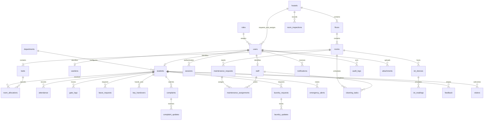

# SmartStay architecture

## Runtime and layers

Node.js 24 provides HTTP, SQLite, cryptographic password hashing, and session tokens. The browser uses native JavaScript modules and semantic HTML/CSS. There is no build step or external service dependency.

```text
public/
  index.html, login.html, register.html, app.html  Public pages and residence shell
  js/app.js                       Routing, sidebar, global search, profile, notifications
  js/components.js                Tables, forms, dialogs, CSV, safe rendering, feedback
  js/pages/dashboard.js           Admin, warden, and student command centers
  js/pages/people.js              Student profiles, import, wardens, staff
  js/pages/housing.js             Blocks, floor view, rooms, beds, allocation, cleaning
  js/pages/attendance-gate.js      Attendance, biometric demo, gate, keys, visitors
  js/pages/operations.js           Leaves, maintenance, complaints, laundry
  js/pages/campus.js               Notifications, safety, IoT
  js/pages/reports.js              Reports, settings, recovery, private feedback
  js/pages/approvals.js            Admin registration review and account management
  js/pages/department-settings.js  Shared engineering department configuration
server/
  server.js                       HTTP transport, sessions, guarded routes, scheduler
  security.js                     Hashing, validation, role permissions, Admin code check
  accounts.js                     Pending registration, Admin approval and suspension
  migrations.js                   Versioned additive schema/data updates and SQLite backups
  seed-config.js                  Canonical four hostel types and initial departments
  controllers.js                  Module reads/writes and allowed workflow transitions
  services.js                     Transactional allocation, gate, attendance, files, curfew alerts
  repositories.js                 Prepared queries, ownership/hostel scope, notifications, audit
  db.js                           Connection, transactions, migrations, idempotent seed
  schema.sql                      Relational database model, indexes, constraints
data/smartstay.sqlite              Durable application data, created on first start
tests/                            Isolated API and Chrome browser verification
```

## Relational model



Hostel settings, identity-verified recovery requests, and seed version records complete the model. Unique active-allocation indexes prevent a student or bed from having multiple live assignments. Foreign keys are enabled for every connection. Attendance is unique per student and date; rooms, student codes, registration numbers, emails, and ticket codes are unique. Files are stored in SQLite and fetched through authenticated, scoped endpoints. File types are checked against their signatures.

## Routes

| Surface | Routes |
|---|---|
| Public | `/`, `/login`, `/api/public` |
| Identity | `/api/auth/login`, `/api/auth/logout`, `/api/auth/forgot`, `/api/auth/password`, `/api/auth/recover`, `/api/me` |
| Application | `/app/dashboard` and `/app/{module}` for each authorized sidebar module |
| Data | `/api/students`, `/api/hostels`, `/api/rooms`, `/api/allocations`, `/api/wardens`, `/api/staff` |
| Movement | `/api/attendance`, `/api/gate`, `/api/leaves`, `/api/keys`, `/api/visitors` |
| Services | `/api/maintenance`, `/api/complaints`, `/api/laundry`, `/api/cleaning`, `/api/inspections`, `/api/feedback` |
| Campus | `/api/notifications`, `/api/safety`, `/api/iot`, `/api/reports`, `/api/settings`, `/api/search`, `/api/attachments/{id}` |

GET reads records; POST creates requests/actions; PATCH updates an existing record at `/api/{module}/{id}`. Shared actions use JSON and the `X-SmartStay-Request: 1` header. All writes provide validation and structured success/error responses. CSV export happens in the browser from authorized data; cells that could execute spreadsheet formulas are escaped.

## Authorization

| Role | Access |
|---|---|
| Admin | All 19 navigation modules, user approvals, all four hostels, department configuration, account recovery and audit log |
| Warden | Assigned-hostel students, allocation, attendance, leaves, services, inspections, reports, announcements and safety; staff directory is read-only |
| Student | Own room, attendance, gate/leave history, service requests, notifications, safety and account settings; private service feedback |
| Security | Gate operation, minimal student scan details, approved/active leave list, key custody, visitors, notifications, safety, personal settings |
| Maintenance | Assigned tickets, resolution updates, assigned cleaning tasks, rooms, notifications and personal settings |
| Laundry | Laundry lifecycle, notifications and personal settings |

Both API routes and direct application URLs enforce role access and approved account status. Student queries are scoped to their identity. Warden, security, maintenance and laundry requests are scoped to their current assigned hostel; unauthorized global or foreign-hostel filters fail on the backend. Confidential complaint identities are inaccessible to security, maintenance and laundry roles. Maintenance file downloads require an assigned ticket. Student roommates' identities are not exposed by the room endpoint.

Passwords use scrypt with random salts. Sessions use random 256-bit opaque tokens, store only SHA-256 digests, expire, and use HttpOnly/SameSite=Strict cookies. Enable `COOKIE_SECURE=true` when serving through HTTPS. Password changes, resets and deactivation revoke sessions. Cross-origin writes and requests without the verification header are rejected. Prepared statements protect SQL inputs; browser text is escaped; CSP, frame restrictions and MIME checks protect the browser surface. Login and account-recovery requests are rate limited.

## Connected workflows

- **Register/approve:** Student or employee registration creates a PENDING account and an Admin notification. Admin confirms hostel assignment and approves or rejects with a recorded reason. Room allocation remains separate. Suspension, restoration and reassignment are audited; changed access revokes existing sessions. Admin uses a dedicated login endpoint and backend `ADMIN_SECURITY_CODE`.
- **Allocate/transfer/vacate:** one transaction changes allocation history, bed state and student residence; occupied/maintenance beds and duplicate assignments are rejected. Deactivation releases the active allocation.
- **Leave:** Pending → Approved/Rejected → Active on gate exit → Completed on gate entry. Leave dates do not falsely mark a resident outside before actual departure. Approval notifies the student and security; emergency requests receive priority alerts.
- **Gate:** exit stores expected return and reason, changes presence and attendance; entry records presence and completes active leave. IST gate timings and expected return determine late status. A minute scheduler flags overdue residents and residents still outside after curfew; notifications are deduplicated using the gate record. The command center refreshes every 30 seconds when the user is idle.
- **Keys:** submitted and returned records retain receiving staff and timestamps. Room details show keys currently in custody.
- **Maintenance:** Reported → Assigned → In Progress → Resolved → Verified. Staff can work only their assigned requests; students verify their own resolved repairs. Assignments and resolution times are retained.
- **Complaints:** Submitted → Under Review → Assigned → Resolved → Closed. Updates form a private timeline. Unresolved concerns over three days are flagged, and explicit escalation notifies management.
- **Laundry:** Requested → Collected → Washing → Ready → Delivered. Updates are timestamped, and ready/delivered notifications go to the requester.
- **Emergency:** confirmed submission → Active → Acknowledged → Resolved. The assigned warden, admin and security receive high-priority in-app alerts.
- **Cleaning/inspection:** assignments, scheduled dates, completion, issues and follow-up actions are persisted; only authorized staff can complete assigned tasks.

## Integration boundary

IoT and biometric modules are explicitly labelled demos. Database events provide a future adapter boundary: replace the simulated event producer with a trusted, authenticated hardware gateway while retaining the same attendance/gate services. Current events do not collect biometric images or measurements from physical devices.

Notifications are in-app; SMS/email delivery and real emergency services are external integrations. Recovery requests are persisted for identity verification by the residence office. No fictitious email sending or physical dispatch is claimed.

## Validation

API tests use an in-memory SQLite database and an ephemeral server; persistence checks use separate test databases across process restarts. Browser suites use independent in-memory servers on ports 5002 and 5004, cover existing role pages plus registration/approval, and check 1920, 1440, 1024, 768, 430 and 390 pixel widths. Test screenshots/results are local review artifacts. Persistent application records remain separate from test mutations. See [UPDATE-V2.md](UPDATE-V2.md) for setup, migration details and security-code configuration.
